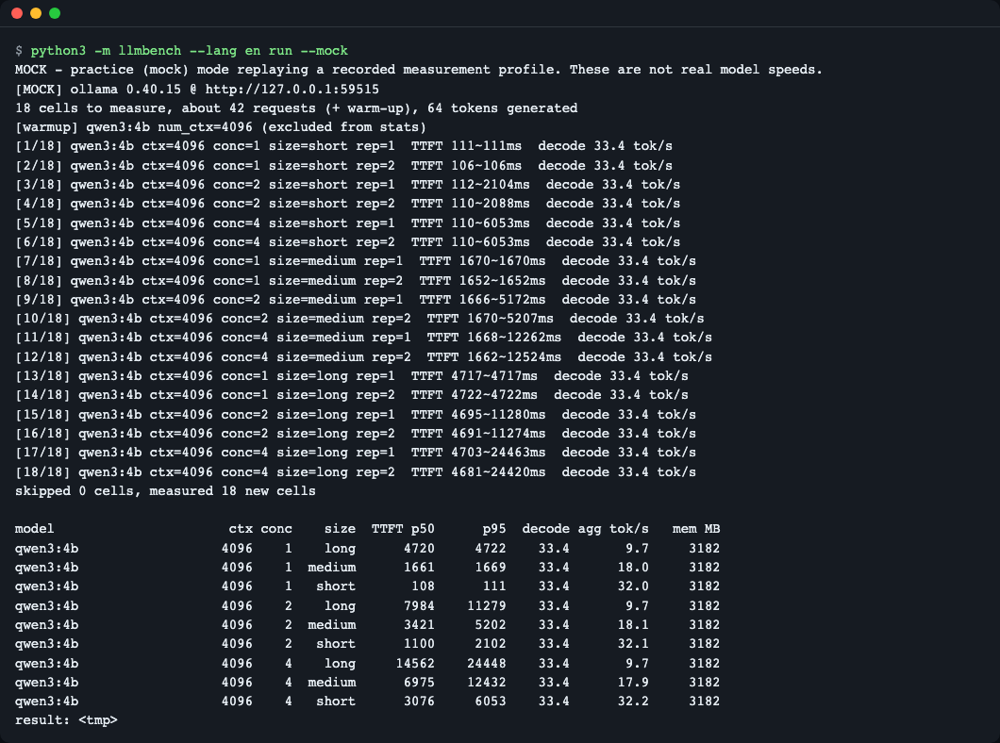
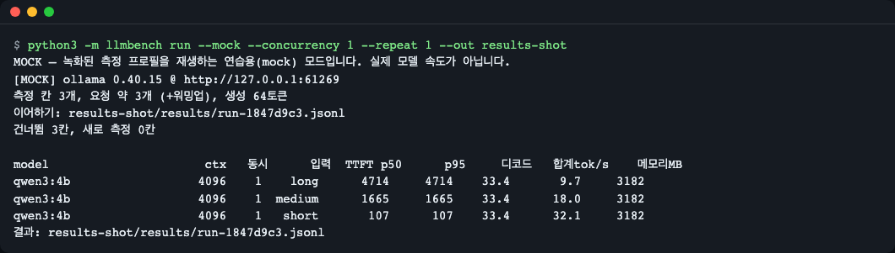
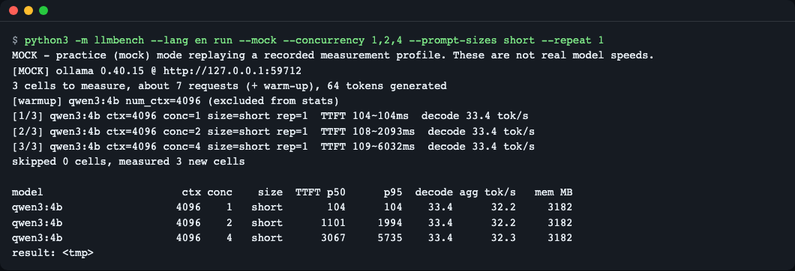
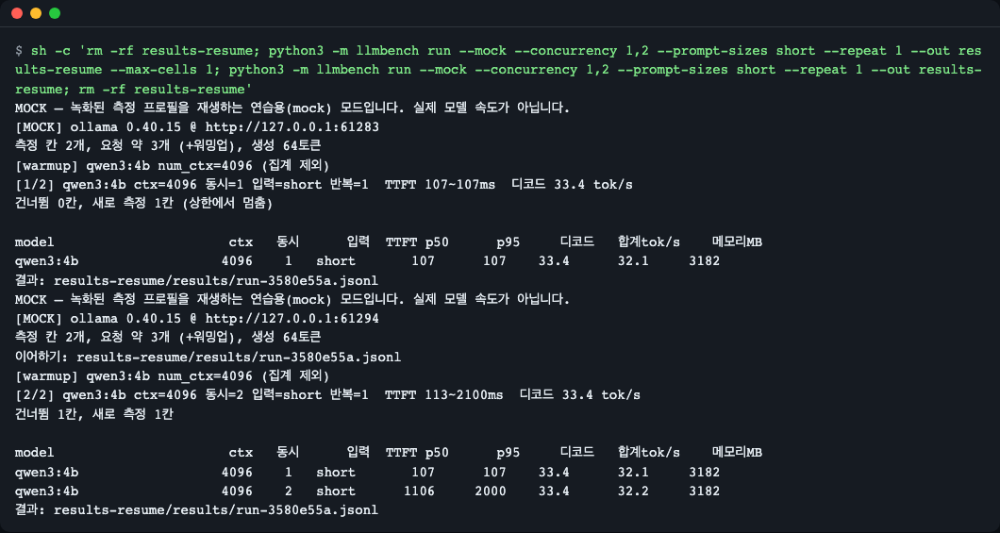
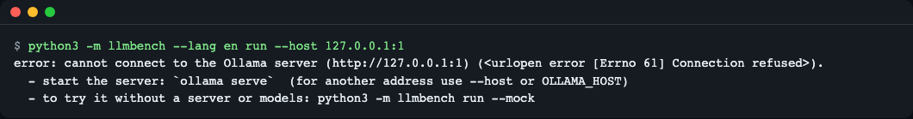
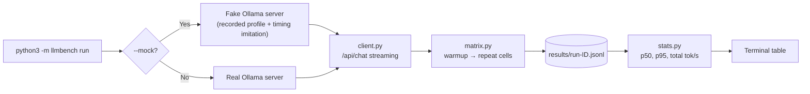

# ai-lab-local-llm-bench — Measure local LLM speed split into "queue, load, prefill, decode"

**English** | [한국어](README.ko.md)

A small, dependency-free Python tool that benchmarks a local Ollama server and shows where time goes: queue, model load, prefill (prompt processing) and decode (token generation). Try it in one command without any model or API key: `python3 -m llmbench run --mock` (a practice mode that replays a recorded timing profile through a fake Ollama server). **Status: milestone M1 (measurement core).** SVG charts, a markdown report, quantization comparison (Q4/Q8/FP16) and side-by-side answer quality are planned for M2/M3 and are not implemented yet.

```text
$ python3 -m llmbench run --mock

model                      ctx   동시      입력  TTFT p50      p95     디코드   합계tok/s    메모리MB
qwen3:4b                  4096    1    long      4854     4931    33.4       9.5     3182
qwen3:4b                  4096    1  medium      1691     1720    33.4      17.9     3182
qwen3:4b                  4096    1   short       132      133    33.4      31.7     3182
...  (동시 2·4 의 long·medium 행 생략)
qwen3:4b                  4096    2   short      1127     2129    33.4      32.0     3182
qwen3:4b                  4096    4   short      3118     6121    33.4      31.9     3182
```

<sub>Result preview (screen from the practice mock mode). As the input gets longer, only TTFT grows while decode speed stays the same; as concurrent requests increase, only the TTFT p95 climbs like a staircase. The text block above is a copy of part of the same output.</sub>

## In one line

Run a measurement with a single command against the Ollama on your laptop (or the practice fake server), and read in a table how **input length** and the **number of concurrent requests** affect time to first token (TTFT), generated tokens per second and memory.

**Who it is for:** people who have used local models with Ollama but only have a gut feeling for "why it is slow" / people who want to learn what benchmark numbers (TTFT, tok/s) mean by building them themselves / people who want to see how a measurement tool is written with only the standard library

> **What works now (M1) and what does not yet**
>
> | Feature | Status |
> |---|---|
> | Measurement matrix (input length x concurrent requests x repeats), table of TTFT, decode, total tok/s and memory | Done |
> | Practice mock mode (fake Ollama server), resume after interruption, no-server guidance | Done |
> | Quantization (Q4, Q8, FP16) comparison | Not yet (M2) — the mock profile has only one set of values, for `qwen3:4b` Q4_K_M, and Q8 and FP16 were not measured |
> | Side-by-side answers to the same question per quantization | Not yet (M2) |
> | Charts (SVG) and markdown report (`report`) | Not yet (M3) |

## Why should you know this?

Picture a restaurant. From the moment a customer orders until the first dish arrives, it takes (1) time waiting in line behind earlier customers, (2) time to open the kitchen, and (3) time to prep the ingredients; only then (4) do dishes come out onto the plate one by one. A local LLM is the same. After waiting in the queue, loading the model, and reading the input (prefill), characters (tokens) finally start coming out one at a time (decode). Only if you know which stage causes the "slow" feeling can you choose whether to shorten the input, reduce concurrent requests, or switch models. This tool measures those stages separately.

## Run it in 30 seconds

You need: Python 3.10 or later, and git. No external packages are needed (standard library only). [Ollama](https://ollama.com) is needed only for the real-model mode. (The output in this README was produced on Python 3.15.2, macOS.)

```bash
git clone https://github.com/LeeGyeongPil/ai-lab-local-llm-bench.git
cd ai-lab-local-llm-bench
python3 -m llmbench run --mock
```

It finishes in about 18 seconds. The first two lines tell you the mode.

```text
MOCK — 녹화된 측정 프로필을 재생하는 연습용(mock) 모드입니다. 실제 모델 속도가 아닙니다.
[MOCK] ollama 0.40.15 @ http://127.0.0.1:49339
측정 칸 18개, 요청 약 42개 (+워밍업), 생성 64토큰
[warmup] qwen3:4b num_ctx=4096 (집계 제외)
[1/18] qwen3:4b ctx=4096 동시=1 입력=short 반복=1  TTFT 130~130ms  디코드 33.4 tok/s
[2/18] qwen3:4b ctx=4096 동시=1 입력=short 반복=2  TTFT 134~134ms  디코드 33.4 tok/s
[3/18] qwen3:4b ctx=4096 동시=2 입력=short 반복=1  TTFT 120~2124ms  디코드 33.4 tok/s
...
```

(The port number differs on every run. The tool's output is in Korean: "MOCK — practice (mock) mode that replays a recorded measurement profile. These are not real model speeds." / "18 measurement cells, about 42 requests (+warmup), 64 generated tokens" / "동시" = concurrency, "입력" = input, "반복" = repeat, "디코드" = decode.)

**What is the practice mock mode?** It does not run a real model. Using numbers measured once (`fixtures/profiles.json`), a **fake server that streams responses over HTTP just like a real Ollama** merely imitates the timing. Without a model or a key, you get the same result shape even in CI. The numbers are **not** the real speed of your laptop. Time is run 10 times faster, and the reported values are converted back to the original scale (which is why it finishes in 18 seconds).

To measure with a real local model (real mode loads the model into memory, so it can be slow, and on a shared server the numbers can fluctuate because of other people's work):

```bash
ollama pull qwen3:4b
python3 -m llmbench run --models qwen3:4b --concurrency 1 --prompt-sizes short,long --repeat 1 --num-predict 24
```

The result of actually running this command at the time of writing (Ollama 0.40.15, shared server, Apple silicon):

```text
[REAL] ollama 0.40.15 @ http://localhost:11434
측정 칸 2개, 요청 약 2개 (+워밍업), 생성 24토큰
[warmup] qwen3:4b num_ctx=4096 (집계 제외)
[1/2] qwen3:4b ctx=4096 동시=1 입력=short 반복=1  TTFT 113~113ms  디코드 34.6 tok/s
[2/2] qwen3:4b ctx=4096 동시=1 입력=long 반복=1  TTFT 3864~3864ms  디코드 32.3 tok/s
건너뜀 0칸, 새로 측정 2칸

model                      ctx   동시      입력  TTFT p50      p95     디코드   합계tok/s    메모리MB
qwen3:4b                  4096    1    long      3864     3864    32.3       5.2     3182
qwen3:4b                  4096    1   short       113      113    34.6      29.8     3182
결과: results/run-47deefe1.jsonl
```

> If you omit `--models`, the default is the three quantization tags of `qwen3:0.6b` (q4_K_M, q8_0, fp16), but that comparison feature (M2) is not finished yet. In M1, specify a model you already have with `--models`. If you specify a tag that has not been pulled to the server, the tool tells you before measuring (exit code 2) and stops.

## Follow along step by step

How to read the table: **TTFT** = time from sending the request until the first character arrives (ms), **p50/p95** = the median / the boundary of the slowest 5%, **디코드** (decode) = generated tokens per second as reported by the server, **합계tok/s** (total tok/s) = all generated tokens of the batch ÷ the whole batch time, **메모리MB** (memory MB) = estimated memory the model occupies (`size` from `/api/ps`).

### Step 1. Change only the input length


<sub>Figure 1. TTFT by input length (practice mock mode). Numbers vary a little on each run.</sub>

Fix concurrent requests at 1 and compare short, medium and long inputs.

```bash
python3 -m llmbench run --mock --concurrency 1 --repeat 1
```

```text
model                      ctx   동시      입력  TTFT p50      p95     디코드   합계tok/s    메모리MB
qwen3:4b                  4096    1    long      4792     4792    33.4       9.6     3182
qwen3:4b                  4096    1  medium      1696     1696    33.4      17.9     3182
qwen3:4b                  4096    1   short       114      114    33.4      32.1     3182
```

**What does it mean?** The longer the input, the more TTFT grows, from 114ms to 4792ms, but decode stays the same at 33.4 tok/s. **Prefill**, which reads the input, and **decode**, which produces characters, are different stages, so input length affects only TTFT. Total tok/s drops as the input gets longer because prefill time goes into the denominator (it is a different value from decode speed, so read them separately). The real-mode smoke test showed the same shape (short-input TTFT 113ms, long-input 3864ms, decode 34.6 / 32.3 tok/s).

### Step 2. Change only the number of concurrent requests


<sub>Figure 2. Change in TTFT p95 with 1, 2 and 4 concurrent requests (practice mock mode).</sub>

```bash
python3 -m llmbench run --mock --concurrency 1,2,4 --prompt-sizes short --repeat 1
```

```text
model                      ctx   동시      입력  TTFT p50      p95     디코드   합계tok/s    메모리MB
qwen3:4b                  4096    1   short       129      129    33.4      31.8     3182
qwen3:4b                  4096    2   short      1126     2015    33.4      31.9     3182
qwen3:4b                  4096    4   short      3128     5820    33.4      32.0     3182
```

**What does it mean?** Even as concurrent requests grow 1 → 2 → 4, total tok/s stays **flat** at about 32, and only TTFT p95 rises **like a staircase**, 129 → 2015 → 5820ms. With Ollama's default setting (`OLLAMA_NUM_PARALLEL=1`), requests are handled one at a time and the rest wait in line. The time spent waiting is recorded separately in the result file as `queue_ms` (an estimate of the queue time).

### Step 3. Stop and resume measuring


<sub>Figure 3. After stopping with `--max-cells 1`, the same command measures the rest.</sub>

Measurements are saved one line per cell (batch) in a JSONL file. If you run the same command again, finished cells are skipped. Here we deliberately measure one cell with `--max-cells 1`, stop, and then resume.

```bash
python3 -m llmbench run --mock --concurrency 1,2 --prompt-sizes short --repeat 1 --out /tmp/llmb-demo --max-cells 1   # Measure 1 cell and stop
python3 -m llmbench run --mock --concurrency 1,2 --prompt-sizes short --repeat 1 --out /tmp/llmb-demo                  # Same command (only --max-cells removed) → measures only the remaining cells
```

```text
[1/2] qwen3:4b ctx=4096 동시=1 입력=short 반복=1  TTFT 109~109ms  디코드 33.4 tok/s
건너뜀 0칸, 새로 측정 1칸 (상한에서 멈춤)
  ...
[2/2] qwen3:4b ctx=4096 동시=2 입력=short 반복=1  TTFT 136~2124ms  디코드 33.4 tok/s
건너뜀 1칸, 새로 측정 1칸
```

(Output: "건너뜀 0칸, 새로 측정 1칸 (상한에서 멈춤)" = "skipped 0 cells, newly measured 1 cell (stopped at the limit)".)

**What does it mean?** Even if you stop a long real measurement with Ctrl+C (`중단했습니다. 같은 명령을 다시 실행하면 이어서 측정합니다`, i.e. "Interrupted. Run the same command again to continue measuring"), the earlier part is kept. The result file name (run-id) is a hash of the settings, so it resumes only if **the settings are the same**. To measure from scratch, add `--fresh`.

### Step 4. When there is no server


<sub>Figure 4. Guidance message when connecting to the server fails (exit code 2).</sub>

```bash
python3 -m llmbench run --host 127.0.0.1:1
```

```text
오류: Ollama 서버(http://127.0.0.1:1)에 연결할 수 없습니다 (<urlopen error [Errno 61] Connection refused>).
  - 서버를 켜세요: `ollama serve`  (다른 주소면 --host 또는 OLLAMA_HOST)
  - 서버·모델 없이 먼저 해 보려면: python3 -m llmbench run --mock
```

(The message says: "Error: cannot connect to the Ollama server. Start the server with `ollama serve` (use --host or OLLAMA_HOST for another address). To try it first without a server or model: python3 -m llmbench run --mock".)

The exit code is 2. (`Errno 61` is the macOS value; on Linux it appears as `Errno 111`.)

## How does it work?



1. With `--mock`, `run` starts the fake server inside the same process; otherwise it goes to `--host`/`OLLAMA_HOST` (default `http://localhost:11434`).
2. **Mock and real mode use the same client.** So the measurement code genuinely runs even in practice.
3. The fake server does not copy and replay results; it **actually lets time pass** using one slot lock (the queue), load time, prefill time (input tokens ÷ the recorded prefill speed) and per-token decode intervals. The staircase-shaped TTFT arises from this on its own.
4. `matrix.py` does one warmup per model (excluded from aggregation), launches N concurrent requests at once for each cell, and saves the results one line at a time. It prepends a random prefix (`[run xxxx]`) to every request so the **prompt cache** cannot fool TTFT (turn it off with `--no-nonce` to see cache hits).
5. `stats.py` computes p50/p95 and total throughput from the rows excluding warmup and shows them in a table.

## Code tour

| File | What it does |
|---|---|
| [`llmbench/client.py`](llmbench/client.py) | Reads the `/api/chat` stream and measures TTFT and the server phases (load, prefill, decode) |
| [`llmbench/fake_ollama.py`](llmbench/fake_ollama.py) | The fake server for mock mode (imitates queueing, load, prefill and decode) |
| [`llmbench/matrix.py`](llmbench/matrix.py) | Iterates measurement cells, saves JSONL, resumes |
| [`llmbench/stats.py`](llmbench/stats.py) | Percentile and total-throughput aggregation |
| [`llmbench/prompts.py`](llmbench/prompts.py) | Builds short/medium/long prompts |
| [`tests/`](tests) | Tests for staircase TTFT, the input-length effect, cache, resume and no-server |

**Key point 1 — TTFT is the moment the "first chunk with content" arrives** ([`client.py`](llmbench/client.py))

```python
if ttft is None and d.get("message", {}).get("content"):
    ttft = time.perf_counter() - t0
```

An empty chunk can arrive first, so the first piece that has content is used as the reference.

**Key point 2 — The queue is a single lock** ([`fake_ollama.py`](llmbench/fake_ollama.py))

```python
with self.slot:  # 여기서 줄을 선다. 대기 시간은 total_duration 에 그대로 들어간다
```

Because there is a single slot, concurrent requests are handled in order, and the processing time of earlier requests is added to the TTFT of later ones.

**Key point 3 — Queue time is estimated by subtraction** ([`client.py`](llmbench/client.py))

```python
"queue_ms": round(max(0.0, total - load - pe - ev), 1),
```

The server does not report queue time separately, so it is estimated as "total − load − prefill − decode" (values below 0 become 0). It is an estimate.

## Glossary

| Term | Meaning |
|---|---|
| Ollama | A program that runs LLMs on your own computer and makes them usable through an HTTP API |
| Token | The smallest unit in which a model reads and writes text (in English, roughly 4 characters ≒ 1 token) |
| TTFT | Time To First Token. The time from the request until the first token arrives |
| Prefill | The stage where the model reads the whole input. The longer the input, the longer it takes |
| Decode | The stage that produces tokens one at a time. Almost independent of input length |
| tok/s | Tokens per second. Decode tok/s (the generation speed of one request) differs from total tok/s (the whole batch) |
| p50 / p95 | Median / 95th percentile (the boundary of the slowest 5%) |
| Quantization | A way of shrinking weights to fewer bits to make a model smaller and faster (Q4, Q8, etc.). Comparison is planned for M2 |
| Prompt cache | A feature that skips prefill for inputs whose beginning is the same. It can fool measurements, so a random prefix is used to avoid it |
| mock (practice mock) | A fake-server mode that imitates timing with recorded numbers instead of a real model |

## Try changing things yourself

1. **Choose input sizes** — change it like `--mock --prompt-sizes short,long` → only the chosen sizes are measured and the number of cells drops → confirm with the "측정 칸 N개" (N measurement cells) number on the first line and the number of table rows.
2. **Increase concurrent requests** — `--mock --concurrency 1,8` → when I ran it, at concurrency 8 the TTFT p95 was 13378ms and total tok/s stayed flat at 32.0 → compare the `p95` and `합계tok/s` columns of the table.
3. **See the cache effect** — `--mock --no-nonce --concurrency 1 --prompt-sizes long` → when the same long input is repeated, the beginning hits the cache from the second repeat on → confirm with `prompt_eval_cached_count` in the result JSONL. When I ran it, the first repeat had prefill of 4610ms (cache 0), and the second repeat had 1511 of 1512 tokens hit, with prefill of 3ms and TTFT of 61ms (values imitated by the mock). That is why this tool attaches a random prefix by default.

## Common problems

| Symptom | Cause | Fix |
|---|---|---|
| `Ollama 서버(...)에 연결할 수 없습니다` (cannot connect to the Ollama server) | The server is off or the address is different | Run `ollama serve`; for another address use `--host` or `OLLAMA_HOST` |
| `오류: 서버에 없는 모델 태그: …` (error: model tag not on the server) with a `받으려면: ollama pull <태그>` (to pull: ollama pull <tag>) hint, exit code 2 | The specified tag has not been pulled to the server | Run the printed `ollama pull <tag>`, or specify a tag from the `받아 둔 모델` (pulled models) list with `--models`. If the server does not support `/api/tags`, it prints one warning line and proceeds without checking |
| Real mode is very slow | Shared server, or model load, or a long input | Values can fluctuate, so raise `--repeat` and measure again when no other work is running |
| `경고: 다른 모델이 이미 메모리에 있습니다` (warning: another model is already in memory) | Another model affects memory and speed | Unload that model and measure again |
| The same command prints only "건너뜀 N칸" (skipped N cells) | The settings are the same, so earlier results were picked up | To measure from scratch, use `--fresh` or `--run-id` |
| `오류: --prompt-sizes 에 알 수 없는 값 ['huge']` (error: unknown value in --prompt-sizes) or `--concurrency 는 1 이상의 정수 목록이어야 합니다` (--concurrency must be a list of integers of 1 or more) (exit code 2) | Input validation: a value outside the allowed range | Specify `--prompt-sizes` from `short,medium,long`, and `--concurrency` and `--repeat` as integers of 1 or more |
| Mock tests fail on a very slow CI | The tests are based on the wall clock | Lower `--mock-speed` (for example 5) and retry |

## Development and tests

```bash
uv run pytest -q                                   # uv 필요: curl -LsSf https://astral.sh/uv/install.sh | sh
python3 -m unittest discover -s tests -t .         # uv 없이도 가능
```

At the time of writing, all 17 tests passed with both. In a minimal Linux environment you only need `python3` and `git` (`apt-get install -y python3 git`).

## Limits of this document

- The screenshots are taken directly from terminal output, and the numbers differ a little on each run, so they may differ slightly from the code blocks in the body (values from when it was written).
- The mock numbers are a **temporary profile** from a single measurement of `qwen3:4b` (Q4_K_M). In milestone M2 it is planned to be replaced with measurements of the three quantization tags of `qwen3:0.6b`.
- Measurement environment: Ollama 0.40.15, shared server. This is a demo for reading the **shape (staircase, flatness, input-length effect)** rather than the absolute numbers.
- Model existence is checked by comparing the server's `/api/tags` list with the tag string; per-port server lists are not managed separately. It has not yet been run on Linux.

## Learn more

- [Ollama API docs](https://docs.ollama.com/api) — the response's `load_duration`, `prompt_eval_duration` and `eval_duration` (nanoseconds) and the tok/s calculation
- [Ollama FAQ](https://github.com/ollama/ollama/blob/main/docs/faq.mdx) — concurrent requests (`OLLAMA_NUM_PARALLEL`), context and `keep_alive`
- [llama.cpp llama-bench](https://github.com/ggml-org/llama.cpp/blob/master/tools/llama-bench/README.md) — a benchmark that measures prefill and decode separately
- [vLLM benchmark CLI](https://docs.vllm.ai/en/v0.32.0/benchmarking/cli/) — definitions of the TTFT, TPOT and ITL metrics and prefix-cache caveats
- [qwen3 tag list](https://ollama.com/library/qwen3/tags) — tags by size and quantization

(Links checked: 2026-11-09, per the research notes)

## License

MIT — [LICENSE](LICENSE). Ollama (MIT) and the Qwen3 models are not included in this repository and follow their own licenses.
