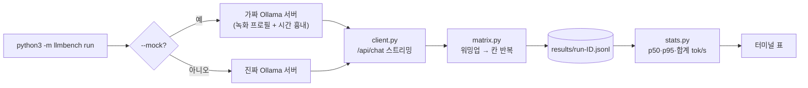

# ai-lab-local-llm-bench — 로컬 LLM 속도를 "대기·로드·프리필·디코드"로 쪼개 재 보기

**한국어** | [English](README.en.md)

> **English summary** — A small, dependency-free Python tool that benchmarks a local Ollama server and shows where time goes: queue, model load, prefill (prompt processing) and decode (token generation). Try it in one command without any model or API key: `python3 -m llmbench run --mock` (a practice mode that replays a recorded timing profile through a fake Ollama server). **Status: milestone M1 (measurement core).** SVG charts, a markdown report, quantization comparison (Q4/Q8/FP16) and side-by-side answer quality are planned for M2/M3 and are not implemented yet.

```text
$ python3 -m llmbench run --mock

model                      ctx   동시      입력  TTFT p50      p95     디코드   합계tok/s    메모리MB
qwen3:4b                  4096    1    long      4854     4931    33.4       9.5     3182
qwen3:4b                  4096    1  medium      1691     1720    33.4      17.9     3182
qwen3:4b                  4096    1   short       132      133    33.4      31.7     3182
...  (동시 2·4 의 long·medium 행 생략)
qwen3:4b                  4096    2   short      1127     2129    33.4      32.0     3182
qwen3:4b                  4096    4   short      3118     6121    33.4      31.9     3182
```

<sub>결과 미리보기(연습용 mock 모드 실행 화면). 입력이 길어지면 TTFT 만 늘고 디코드 속도는 그대로이고, 동시 요청이 늘면 TTFT 의 p95 만 계단처럼 오릅니다. 위 텍스트 블록은 같은 출력의 일부를 복사한 것입니다.</sub>

## 한 줄 요약

내 노트북의 Ollama(또는 연습용 가짜 서버)에 명령 하나로 측정을 돌려, **입력 길이**와 **동시 요청 수**가 첫 토큰 지연(TTFT)·초당 생성 토큰·메모리에 주는 영향을 표로 읽을 수 있습니다.

**이런 분께:** Ollama 로 로컬 모델을 써 봤지만 "왜 느린지"를 감으로만 아는 분 / 벤치마크 숫자(TTFT, tok/s)가 무엇을 뜻하는지 직접 만들어 보며 익히고 싶은 분 / 측정 도구를 표준 라이브러리만으로 어떻게 짜는지 보고 싶은 분

> **지금 되는 것(M1)과 아직 안 되는 것**
>
> | 기능 | 상태 |
> |---|---|
> | 측정 매트릭스(입력 길이 x 동시 요청 x 반복), TTFT·디코드·합계 tok/s·메모리 표 | 됨 |
> | 연습용 mock 모드(가짜 Ollama 서버), 중단 후 이어하기, 서버 없음 안내 | 됨 |
> | 양자화(Q4·Q8·FP16) 비교 | 아직(M2) — mock 프로필은 `qwen3:4b` Q4_K_M 값 하나뿐이고 Q8·FP16 은 측정하지 않았습니다 |
> | 같은 질문의 양자화별 답변 나란히 비교 | 아직(M2) |
> | 그래프(SVG)·마크다운 보고서(`report`) | 아직(M3) |

## 왜 알아야 하나요?

식당을 떠올려 보세요. 손님이 주문하고 첫 요리가 나올 때까지는 ① 앞 손님 때문에 줄 서는 시간, ② 주방을 여는 시간, ③ 재료를 손질하는 시간이 걸리고, 그다음에야 ④ 요리가 접시에 하나씩 나옵니다. 로컬 LLM 도 같습니다. 줄 서기(대기열)·모델 올리기(로드)·입력 읽기(프리필) 뒤에야 글자(토큰)가 한 개씩 나오기(디코드) 시작합니다. "느리다"는 느낌이 어느 단계 때문인지 알아야 입력을 줄일지, 동시 요청을 줄일지, 모델을 바꿀지 고를 수 있습니다. 이 도구는 그 단계를 나눠 재 줍니다.

## 30초 만에 실행하기

준비물: Python 3.10 이상, git. 외부 패키지는 필요 없습니다(표준 라이브러리만 사용). 실제 모델 모드에만 [Ollama](https://ollama.com)가 필요합니다. (이 README 의 출력은 Python 3.15.2, macOS 에서 실행했습니다.)

```bash
git clone https://github.com/LeeGyeongPil/ai-lab-local-llm-bench.git
cd ai-lab-local-llm-bench
python3 -m llmbench run --mock
```

약 18초 뒤 끝납니다. 처음 두 줄이 모드를 알려 줍니다.

```text
MOCK — 녹화된 측정 프로필을 재생하는 연습용(mock) 모드입니다. 실제 모델 속도가 아닙니다.
[MOCK] ollama 0.40.15 @ http://127.0.0.1:49339
측정 칸 18개, 요청 약 42개 (+워밍업), 생성 64토큰
[warmup] qwen3:4b num_ctx=4096 (집계 제외)
[1/18] qwen3:4b ctx=4096 동시=1 입력=short 반복=1  TTFT 130~130ms  디코드 33.4 tok/s
[2/18] qwen3:4b ctx=4096 동시=1 입력=short 반복=2  TTFT 134~134ms  디코드 33.4 tok/s
[3/18] qwen3:4b ctx=4096 동시=2 입력=short 반복=1  TTFT 120~2124ms  디코드 33.4 tok/s
...
```

(포트 번호는 실행마다 다릅니다.)

**연습용 mock 모드란?** 진짜 모델을 돌리지 않습니다. 한 번 실측해 둔 숫자(`fixtures/profiles.json`)를 가지고 **진짜 Ollama 처럼 HTTP 로 응답을 스트리밍하는 가짜 서버**가 시간만 흉내 냅니다. 모델·키 없이 CI 에서도 같은 결과 모양이 나옵니다. 숫자는 실제 내 노트북의 속도가 **아닙니다**. 시간은 10배 빠르게 흘려보내고, 보고하는 값은 원래 척도로 되돌립니다(그래서 18초에 끝납니다).

실제 로컬 모델로 재려면(실제 모드는 모델을 메모리에 올리므로 느릴 수 있고, 공유 서버라면 다른 사람 작업 때문에 숫자가 흔들릴 수 있습니다):

```bash
ollama pull qwen3:4b
python3 -m llmbench run --models qwen3:4b --concurrency 1 --prompt-sizes short,long --repeat 1 --num-predict 24
```

이 명령을 작성 시점에 실제로 실행한 결과(Ollama 0.40.15, 공유 서버, Apple silicon):

```text
[REAL] ollama 0.40.15 @ http://localhost:11434
측정 칸 2개, 요청 약 2개 (+워밍업), 생성 24토큰
[warmup] qwen3:4b num_ctx=4096 (집계 제외)
[1/2] qwen3:4b ctx=4096 동시=1 입력=short 반복=1  TTFT 113~113ms  디코드 34.6 tok/s
[2/2] qwen3:4b ctx=4096 동시=1 입력=long 반복=1  TTFT 3864~3864ms  디코드 32.3 tok/s
건너뜀 0칸, 새로 측정 2칸

model                      ctx   동시      입력  TTFT p50      p95     디코드   합계tok/s    메모리MB
qwen3:4b                  4096    1    long      3864     3864    32.3       5.2     3182
qwen3:4b                  4096    1   short       113      113    34.6      29.8     3182
결과: results/run-47deefe1.jsonl
```

> `--models` 를 생략하면 `qwen3:0.6b` 의 세 가지 양자화 태그(q4_K_M·q8_0·fp16)를 기본값으로 쓰지만, 그 비교 기능(M2)은 아직 완성되지 않았습니다. M1 에서는 `--models` 로 가지고 있는 모델을 지정하세요. 서버에 받지 않은 태그를 지정하면 측정 전에 알려 주고(종료코드 2) 멈춥니다.

## 단계별로 따라 하기

표 읽는 법: **TTFT** = 요청을 보내고 첫 글자가 올 때까지(ms), **p50/p95** = 중앙값 / 느린 쪽 5%의 경계, **디코드** = 서버가 보고한 초당 생성 토큰, **합계tok/s** = 그 배치의 전체 생성 토큰 ÷ 배치 전체 시간, **메모리MB** = 모델이 차지한 메모리 추정치(`/api/ps`의 `size`).

### 1단계. 입력 길이만 바꿔 보기


<sub>그림 1. 입력 길이별 TTFT 비교(연습용 mock 모드). 숫자는 실행마다 조금 달라집니다.</sub>

동시 요청을 1개로 고정하고 짧은/중간/긴 입력을 비교합니다.

```bash
python3 -m llmbench run --mock --concurrency 1 --repeat 1
```

```text
model                      ctx   동시      입력  TTFT p50      p95     디코드   합계tok/s    메모리MB
qwen3:4b                  4096    1    long      4792     4792    33.4       9.6     3182
qwen3:4b                  4096    1  medium      1696     1696    33.4      17.9     3182
qwen3:4b                  4096    1   short       114      114    33.4      32.1     3182
```

**무슨 뜻인가요?** 입력이 길수록 TTFT 가 114ms → 4792ms 로 늘지만 디코드는 33.4 tok/s 로 같습니다. 입력을 읽는 **프리필**과 글자를 만드는 **디코드**는 서로 다른 단계라서, 입력 길이는 TTFT 에만 영향을 줍니다. 합계tok/s 는 프리필 시간이 분모에 들어가 입력이 길수록 낮아집니다(디코드 속도와 다른 값이니 구분해서 읽으세요). 실제 모드 스모크에서도 같은 모양(짧은 입력 TTFT 113ms, 긴 입력 3864ms, 디코드 34.6 / 32.3 tok/s)이었습니다.

### 2단계. 동시 요청 수만 바꿔 보기


<sub>그림 2. 동시 요청 1·2·4개의 TTFT p95 변화(연습용 mock 모드).</sub>

```bash
python3 -m llmbench run --mock --concurrency 1,2,4 --prompt-sizes short --repeat 1
```

```text
model                      ctx   동시      입력  TTFT p50      p95     디코드   합계tok/s    메모리MB
qwen3:4b                  4096    1   short       129      129    33.4      31.8     3182
qwen3:4b                  4096    2   short      1126     2015    33.4      31.9     3182
qwen3:4b                  4096    4   short      3128     5820    33.4      32.0     3182
```

**무슨 뜻인가요?** 동시 요청이 1 → 2 → 4 개로 늘어도 합계tok/s 는 약 32 로 **평평**하고, TTFT p95 만 129 → 2015 → 5820ms 로 **계단처럼** 오릅니다. Ollama 기본 설정(`OLLAMA_NUM_PARALLEL=1`)에서는 요청이 한 번에 하나씩 처리되고 나머지는 줄을 서기 때문입니다. 줄을 선 시간은 `queue_ms`(대기 추정치)로 결과 파일에 따로 기록됩니다.

### 3단계. 중단했다가 이어서 재기


<sub>그림 3. `--max-cells 1` 로 멈춘 뒤 같은 명령으로 나머지를 이어서 측정.</sub>

측정은 칸(배치)마다 JSONL 파일에 한 줄씩 저장됩니다. 같은 명령을 다시 실행하면 끝난 칸은 건너뜁니다. `--max-cells 1` 로 일부러 한 칸만 재고 멈춘 뒤 이어 봅니다.

```bash
python3 -m llmbench run --mock --concurrency 1,2 --prompt-sizes short --repeat 1 --out /tmp/llmb-demo --max-cells 1   # 1칸만 재고 멈춤
python3 -m llmbench run --mock --concurrency 1,2 --prompt-sizes short --repeat 1 --out /tmp/llmb-demo                  # 같은 명령(--max-cells 만 뺌) → 나머지 칸만 측정
```

```text
[1/2] qwen3:4b ctx=4096 동시=1 입력=short 반복=1  TTFT 109~109ms  디코드 33.4 tok/s
건너뜀 0칸, 새로 측정 1칸 (상한에서 멈춤)
  ...
[2/2] qwen3:4b ctx=4096 동시=2 입력=short 반복=1  TTFT 136~2124ms  디코드 33.4 tok/s
건너뜀 1칸, 새로 측정 1칸
```

**무슨 뜻인가요?** 오래 걸리는 실제 측정을 Ctrl+C 로 멈춰도(`중단했습니다. 같은 명령을 다시 실행하면 이어서 측정합니다`) 앞부분은 남습니다. 결과 파일 이름(run-id)은 설정의 해시이므로 **설정이 같아야** 이어집니다. 새로 재려면 `--fresh` 를 붙입니다.

### 4단계. 서버가 없을 때


<sub>그림 4. 서버 연결 실패 시 안내 메시지(종료 코드 2).</sub>

```bash
python3 -m llmbench run --host 127.0.0.1:1
```

```text
오류: Ollama 서버(http://127.0.0.1:1)에 연결할 수 없습니다 (<urlopen error [Errno 61] Connection refused>).
  - 서버를 켜세요: `ollama serve`  (다른 주소면 --host 또는 OLLAMA_HOST)
  - 서버·모델 없이 먼저 해 보려면: python3 -m llmbench run --mock
```

종료 코드는 2 입니다. (`Errno 61` 은 macOS 의 값이고 리눅스에서는 `Errno 111` 로 보입니다.)

## 어떻게 동작하나요?



1. `run` 은 `--mock` 이면 같은 프로세스 안에서 가짜 서버를 띄우고, 아니면 `--host`/`OLLAMA_HOST`(기본 `http://localhost:11434`)로 갑니다.
2. **mock 과 실제가 같은 클라이언트**를 씁니다. 그래서 측정 코드가 연습에서도 진짜로 실행됩니다.
3. 가짜 서버는 결과를 베껴 읽어 주는 게 아니라, 슬롯 잠금 1개(줄 서기)·로드 시간·프리필 시간(입력 토큰 ÷ 녹화된 프리필 속도)·토큰별 디코드 간격으로 **시간을 실제로 흘려보냅니다**. 계단 모양 TTFT 는 여기서 저절로 생깁니다.
4. `matrix.py` 는 모델마다 워밍업 1회(집계 제외)를 하고, 칸마다 동시 N개를 한꺼번에 출발시켜 결과를 한 줄씩 저장합니다. 요청마다 맨 앞에 무작위 접두어(`[run xxxx]`)를 붙여 **프롬프트 캐시**가 TTFT 를 속이지 않게 합니다(`--no-nonce` 로 끄면 캐시 적중을 볼 수 있습니다).
5. `stats.py` 가 워밍업을 뺀 행으로 p50/p95 와 합계 처리량을 계산해 표로 보여 줍니다.

## 코드 둘러보기

| 파일 | 하는 일 |
|---|---|
| [`llmbench/client.py`](llmbench/client.py) | `/api/chat` 스트림을 읽어 TTFT 와 서버 구간(로드·프리필·디코드)을 잼 |
| [`llmbench/fake_ollama.py`](llmbench/fake_ollama.py) | mock 모드의 가짜 서버(줄 서기·로드·프리필·디코드 흉내) |
| [`llmbench/matrix.py`](llmbench/matrix.py) | 측정 칸 반복, JSONL 저장, 이어하기 |
| [`llmbench/stats.py`](llmbench/stats.py) | 백분위수·합계 처리량 집계 |
| [`llmbench/prompts.py`](llmbench/prompts.py) | short/medium/long 프롬프트 만들기 |
| [`tests/`](tests) | 계단 TTFT·입력 길이 효과·캐시·이어하기·서버 없음 시험 |

**핵심 1 — TTFT 는 "내용이 있는 첫 청크"가 도착한 시각** ([`client.py`](llmbench/client.py))

```python
if ttft is None and d.get("message", {}).get("content"):
    ttft = time.perf_counter() - t0
```

빈 청크가 먼저 올 수 있어서 내용이 있는 첫 조각을 기준으로 삼습니다.

**핵심 2 — 줄 서기는 잠금 하나** ([`fake_ollama.py`](llmbench/fake_ollama.py))

```python
with self.slot:  # 여기서 줄을 선다. 대기 시간은 total_duration 에 그대로 들어간다
```

슬롯이 하나라서 동시 요청은 순서대로 처리되고, 뒤 요청의 TTFT 에 앞 요청의 처리 시간이 더해집니다.

**핵심 3 — 대기 시간은 빼서 추정** ([`client.py`](llmbench/client.py))

```python
"queue_ms": round(max(0.0, total - load - pe - ev), 1),
```

서버가 대기열 시간을 따로 알려 주지 않으므로 "전체 − 로드 − 프리필 − 디코드"로 추정합니다(0 미만은 0). 추정치입니다.

## 용어 사전

| 용어 | 뜻 |
|---|---|
| Ollama | 내 컴퓨터에서 LLM 을 돌리고 HTTP API 로 쓰게 해 주는 프로그램 |
| 토큰 | 모델이 글을 읽고 쓰는 최소 단위(영어는 대략 글자 4개 ≒ 1토큰) |
| TTFT | Time To First Token. 요청 후 첫 토큰이 올 때까지의 시간 |
| 프리필(prefill) | 입력 전체를 모델이 읽는 단계. 입력이 길수록 오래 걸림 |
| 디코드(decode) | 토큰을 하나씩 만들어 내는 단계. 입력 길이와 거의 무관 |
| tok/s | 초당 토큰 수. 디코드 tok/s(한 요청의 생성 속도)와 합계 tok/s(배치 전체)는 다름 |
| p50 / p95 | 중앙값 / 95번째 백분위수(느린 5%의 경계) |
| 양자화 | 가중치를 적은 비트로 줄여 작고 빠르게 만드는 방법(Q4·Q8 등). 비교는 M2 예정 |
| 프롬프트 캐시 | 앞부분이 같은 입력의 프리필을 건너뛰는 기능. 측정을 속일 수 있어 무작위 접두어로 피함 |
| mock(연습용 목) | 실제 모델 대신 녹화된 숫자로 시간을 흉내 내는 가짜 서버 모드 |

## 직접 바꿔 보기

1. **입력 크기 고르기** — `--mock --prompt-sizes short,long` 처럼 바꿉니다 → 고른 크기만 재고 칸 수가 줄어듭니다 → 첫 줄의 "측정 칸 N개" 숫자와 표 행 수로 확인합니다.
2. **동시 요청 늘리기** — `--mock --concurrency 1,8` → 실행해 보니 동시 8 에서 TTFT p95 13378ms, 합계tok/s 32.0 으로 평평했습니다 → 표의 `p95` 와 `합계tok/s` 열을 비교합니다.
3. **캐시 효과 보기** — `--mock --no-nonce --concurrency 1 --prompt-sizes long` → 같은 긴 입력을 반복하면 둘째 반복부터 앞부분이 캐시에 적중합니다 → 결과 JSONL 의 `prompt_eval_cached_count` 로 확인합니다. 실행해 보니 첫 반복은 프리필 4610ms(캐시 0)였고, 둘째 반복은 1512토큰 중 1511토큰이 적중해 프리필 3ms, TTFT 61ms 였습니다(mock 이 흉내 낸 값). 그래서 이 도구는 기본으로 무작위 접두어를 붙입니다.

## 자주 겪는 문제

| 증상 | 원인 | 해결 |
|---|---|---|
| `Ollama 서버(...)에 연결할 수 없습니다` | 서버가 꺼져 있거나 주소가 다름 | `ollama serve` 실행, 다른 주소면 `--host` 또는 `OLLAMA_HOST` |
| `오류: 서버에 없는 모델 태그: …` 와 `받으려면: ollama pull <태그>` 안내, 종료코드 2 | 지정한 태그를 서버에 받지 않음 | 출력된 `ollama pull <태그>` 를 실행하거나, `받아 둔 모델` 목록의 태그를 `--models` 로 지정. 서버가 `/api/tags` 를 지원하지 않으면 경고 한 줄 후 확인 없이 진행 |
| 실제 모드가 매우 느림 | 공유 서버이거나 모델 로드·긴 입력 | 값이 흔들릴 수 있으니 `--repeat` 를 늘리고 다른 작업이 없을 때 재측정 |
| `경고: 다른 모델이 이미 메모리에 있습니다` | 다른 모델이 메모리·속도에 영향 | 해당 모델을 내리고 다시 측정 |
| 같은 명령인데 "건너뜀 N칸"만 나옴 | 설정이 같아 이전 결과를 이어받음 | 새로 재려면 `--fresh` 또는 `--run-id` |
| `오류: --prompt-sizes 에 알 수 없는 값 ['huge']` 또는 `--concurrency 는 1 이상의 정수 목록이어야 합니다` (종료 코드 2) | 입력 검증: 허용 범위 밖의 값 | `--prompt-sizes` 는 `short,medium,long` 중에서, `--concurrency`·`--repeat` 는 1 이상의 정수로 지정 |
| 아주 느린 CI 에서 mock 시험이 실패 | 시험이 벽시계 기반 | `--mock-speed` 를 낮춰(예: 5) 재시도 |

## 개발·시험

```bash
uv run pytest -q                                   # uv 필요: curl -LsSf https://astral.sh/uv/install.sh | sh
python3 -m unittest discover -s tests -t .         # uv 없이도 가능
```

둘 다 작성 시점에 17개 시험이 모두 통과했습니다. 리눅스 최소 환경에서는 `python3` 와 `git` 만 있으면 됩니다(`apt-get install -y python3 git`).

## 이 문서의 한계

- 스크린샷은 터미널 출력을 그대로 찍은 것이고, 숫자는 실행마다 조금씩 달라서 본문 코드 블록(작성 시 실행한 값)과 약간 다를 수 있습니다.
- mock 숫자는 `qwen3:4b`(Q4_K_M) 한 번의 실측에서 온 **임시 프로필**입니다. 마일스톤 M2 에서 `qwen3:0.6b` 세 양자화 태그의 실측으로 교체할 예정입니다.
- 측정 환경 정보: Ollama 0.40.15, 공유 서버. 절대 숫자보다 **모양(계단·평평함·입력 길이 효과)**을 읽는 데모입니다.
- 모델 존재 확인은 서버의 `/api/tags` 목록과 태그 문자열을 비교하며, 포트별 서버 목록은 따로 관리하지 않습니다. 리눅스 환경에서는 아직 실행해 보지 않았습니다.

## 더 알아보기

- [Ollama API 문서](https://docs.ollama.com/api) — 응답의 `load_duration`·`prompt_eval_duration`·`eval_duration`(나노초)와 tok/s 계산
- [Ollama FAQ](https://github.com/ollama/ollama/blob/main/docs/faq.mdx) — 동시 요청(`OLLAMA_NUM_PARALLEL`)·컨텍스트·`keep_alive`
- [llama.cpp llama-bench](https://github.com/ggml-org/llama.cpp/blob/master/tools/llama-bench/README.md) — 프리필·디코드를 따로 재는 벤치마크
- [vLLM 벤치마크 CLI](https://docs.vllm.ai/en/v0.32.0/benchmarking/cli/) — TTFT·TPOT·ITL 지표 정의와 프리픽스 캐시 주의점
- [qwen3 태그 목록](https://ollama.com/library/qwen3/tags) — 크기·양자화별 태그

(링크 확인일: 2026-11-09, 조사 기록 기준)

## 라이선스

MIT — [LICENSE](LICENSE). Ollama(MIT)와 Qwen3 모델은 이 레포에 포함되어 있지 않으며 각자의 라이선스를 따릅니다.
